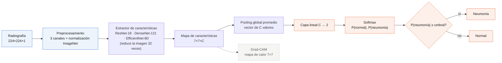
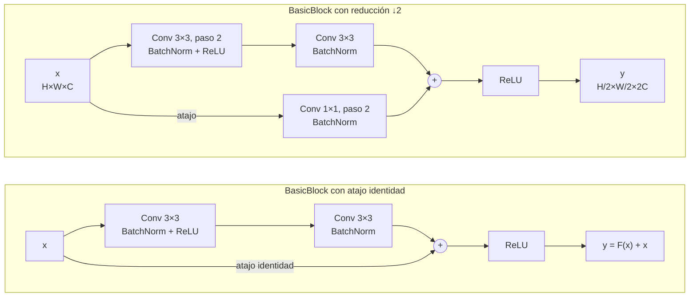
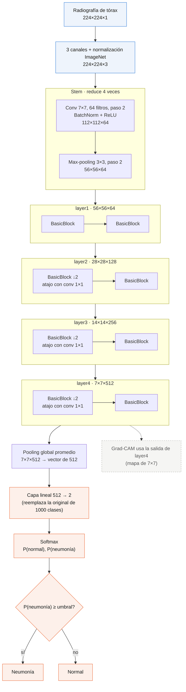
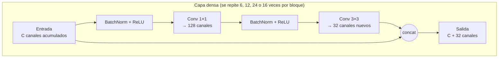
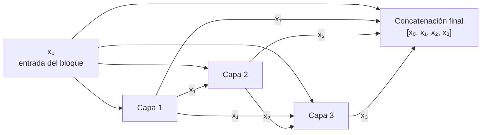
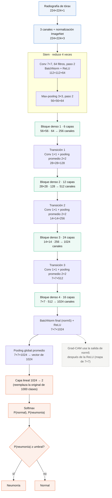
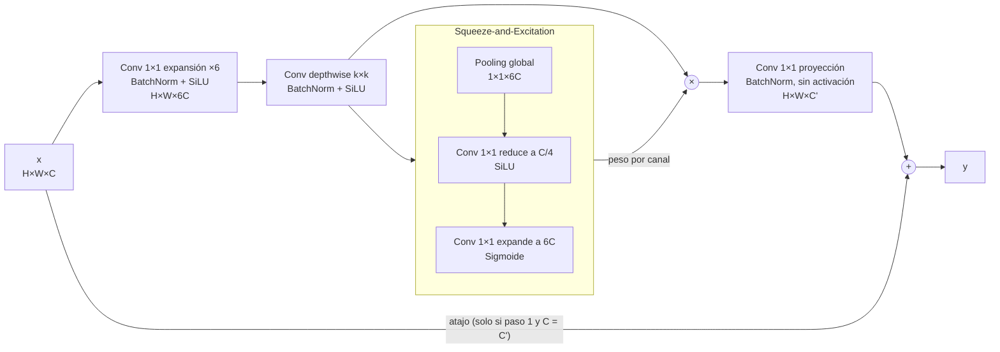
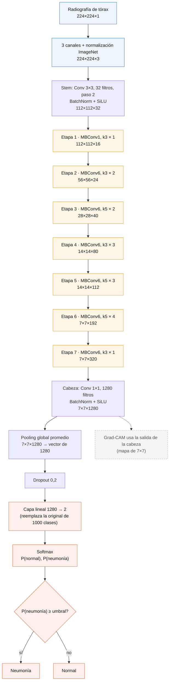

# Arquitecturas de los modelos usados para detectar neumonía

Este documento describe las tres redes neuronales convolucionales entrenadas en el estudio sobre la resolución mínima para detectar neumonía en radiografías de tórax pediátricas (PneumoniaMNIST, MedMNIST v2): **ResNet-18**, **DenseNet-121** y **EfficientNet-B0**. Para cada una se explica la idea que la define, su arquitectura capa por capa, por qué se eligió y qué mostró en los resultados.

Todas las dimensiones de los diagramas corresponden a una entrada de **224×224 px** y se escriben como alto × ancho × canales.

---

## 1. Elementos comunes a los tres modelos

Las tres redes siguen el mismo esquema: un **extractor de características** (las capas convolucionales, también llamado *backbone*) transforma la radiografía en un mapa de características; un **pooling global** lo resume en un vector; y una **capa lineal** produce dos valores, uno por clase.

### 1.1 Transfer learning desde ImageNet

Ninguna red se entrenó desde cero. Las tres parten de los pesos aprendidos en **ImageNet** (1,2 millones de fotografías de 1 000 categorías). Las primeras capas de una red así ya detectan bordes, texturas y formas, patrones útiles también en una radiografía. Con solo 4 708 imágenes de entrenamiento, partir de cero habría rendido peor y habría tendido al sobreajuste.

Se aplicó **ajuste fino completo**: se entrenaron todas las capas, no solo la última, con una tasa de aprendizaje baja (10⁻⁴, optimizador AdamW). Así la red se adapta a las radiografías sin destruir lo aprendido en ImageNet.

### 1.2 Adaptación de la entrada y de la salida

- **Entrada.** Las radiografías tienen un solo canal (gris), pero las redes de ImageNet esperan tres (RGB). La imagen se replica en 3 canales idénticos y se normaliza con la media y la desviación estándar de ImageNet.
- **Salida.** La capa lineal original de 1 000 salidas se reemplazó por una de **2 salidas** (normal y neumonía). Un softmax convierte esas salidas en probabilidades.
- **Decisión.** La probabilidad de neumonía se compara con un **umbral** elegido en el conjunto de validación (índice de Youden), no con 0,5.
- **Pérdida.** Entropía cruzada **ponderada por clase**, porque hay casi 3 radiografías con neumonía por cada normal.

### 1.3 Reducción espacial de 32 veces

Las tres arquitecturas reducen la imagen a la mitad cinco veces (2⁵ = 32). Esto condiciona el estudio de resolución:

| Resolución de entrada | Mapa final | Consecuencia |
|---|---|---|
| 224 px | 7×7 | Grad-CAM con detalle aceptable |
| 128 px | 4×4 | Grad-CAM burdo |
| 64 px | 2×2 | Grad-CAM solo distingue cuadrantes |
| 28 px | menor que 1×1 | DenseNet-121 no puede procesarla; se reescala a 32 px dentro del modelo y el mapa queda en 1×1 |

Para que la comparación fuera justa, el reescalado de 28 a 32 px se aplicó a las tres redes, no solo a DenseNet-121. El reescalado aumenta el número de píxeles, pero no la información de la imagen.

### 1.4 Por qué estas tres arquitecturas

Las tres representan **filosofías de diseño distintas** en la evolución de las redes convolucionales:

| Arquitectura | Año | Cómo combina la información entre capas |
|---|---|---|
| ResNet-18 | 2016 | **Suma** la entrada de cada bloque a su salida (conexión residual) |
| DenseNet-121 | 2017 | **Concatena** las salidas de todas las capas anteriores |
| EfficientNet-B0 | 2019 | Bloques **eficientes** (convolución depthwise + atención por canal), diseñados por búsqueda automática |

Que las tres coincidan en la misma resolución mínima (128 px) indica que el resultado depende del problema y no de una arquitectura en particular. No se usaron Vision Transformers porque suelen necesitar muchos más datos, y a 28 o 64 px una imagen se divide en muy pocos "parches", lo que los deja en desventaja.

---

## 2. ResNet-18

### 2.1 Idea central: las conexiones residuales

Antes de ResNet (He et al., 2016) se observaba un fenómeno contraintuitivo: al apilar más capas, la red rendía **peor**, incluso en entrenamiento. No era sobreajuste. El gradiente se debilitaba al atravesar tantas capas y las primeras dejaban de aprender (problema de *degradación*).

La solución fue el **atajo residual**: la entrada de un bloque se suma a su salida.

$$y = F(x) + x$$

En lugar de aprender una transformación completa, cada bloque aprende solo una **corrección** F(x) sobre lo que ya recibe. Si un bloque no aporta nada, basta con que aprenda F(x) ≈ 0 y la información pasa intacta. Además, el atajo ofrece una vía directa para que el gradiente llegue a las primeras capas durante el entrenamiento.

### 2.2 El bloque básico (BasicBlock)

Cada bloque tiene dos convoluciones 3×3, cada una seguida de normalización por lotes (BatchNorm), y el atajo. Existen dos variantes:

- **Con atajo identidad:** la entrada se suma tal cual, porque tiene las mismas dimensiones que la salida.
- **Con reducción:** el primer bloque de layer2, layer3 y layer4 reduce la resolución a la mitad (paso 2) y duplica los canales. El atajo necesita una convolución 1×1 con paso 2 para que las dimensiones coincidan antes de sumar.

### 2.3 Arquitectura completa

| Etapa | Contenido | Canales | Salida a 224 px |
|---|---|---|---|
| Stem | Conv 7×7, paso 2 + max-pooling 3×3, paso 2 | 64 | 56×56 |
| layer1 | 2 BasicBlocks | 64 | 56×56 |
| layer2 | 2 BasicBlocks (el primero reduce) | 128 | 28×28 |
| layer3 | 2 BasicBlocks (el primero reduce) | 256 | 14×14 |
| layer4 | 2 BasicBlocks (el primero reduce) | 512 | 7×7 |
| Clasificador | Pooling global + capa lineal | 512 → 2 | — |

**Conteo de capas (18):** 1 convolución inicial + 16 convoluciones en los 8 bloques + 1 capa lineal. Las convoluciones 1×1 de los atajos no se cuentan.

**Características en este trabajo:** 11,2 millones de parámetros, 42,7 MB y 3,63 GFLOPs por imagen a 224 px. Grad-CAM se calcula sobre el último bloque de `layer4`.

### 2.4 Por qué se usó

- **Es la referencia de MedMNIST.** El artículo de MedMNIST v2 (Yang et al., 2023) reporta sus resultados de referencia con ResNet-18 y ResNet-50. Incluirla permite comparar los resultados con la literatura.
- **Es una buena línea base:** simple y muy estudiada. Si una arquitectura más compleja no la supera, la complejidad adicional no se justifica.
- **Es poco profunda.** Con 18 capas tiene menos riesgo de sobreajuste en un dataset pequeño que versiones más profundas como ResNet-50.

### 2.5 Qué mostró en los resultados

| Resolución | AUC | Sensibilidad | Especificidad |
|---|---|---|---|
| 28 px | 0.962 ± 0.008 | 0.985 ± 0.009 | 0.702 ± 0.053 |
| 64 px | 0.963 ± 0.013 | 0.997 ± 0.006 | 0.725 ± 0.016 |
| 128 px | 0.982 ± 0.009 | 0.998 ± 0.001 | 0.738 ± 0.013 |
| 224 px | 0.990 ± 0.002 | 0.992 ± 0.004 | 0.866 ± 0.028 |

ResNet-18 empató en el mejor AUC a 224 px, pero fue la red cuya especificidad más dependió de la resolución: entre 128 y 224 px su AUC cambia solo 0.008, mientras que la especificidad sube de 0.74 a 0.87. Es el ejemplo más claro de que el AUC puede ocultar diferencias clínicamente importantes. Fue también la más rápida en GPU (3,4 ms por imagen), aunque es la más pesada en disco.

---

## 3. DenseNet-121

### 3.1 Idea central: reutilizar todas las características

DenseNet (Huang et al., 2017) lleva la idea de ResNet un paso más allá. En lugar de **sumar** la entrada a la salida, cada capa recibe la **concatenación** de las salidas de todas las capas anteriores de su bloque:

$$x_\ell = H_\ell\big([x_0, x_1, \ldots, x_{\ell-1}]\big)$$

donde $[\cdot]$ es la concatenación por canales y $H_\ell$ es la transformación de la capa $\ell$. Esto tiene tres efectos:

- **Reutilización de características.** Un borde detectado al inicio sigue disponible, intacto, para las capas profundas; no hace falta volver a aprenderlo.
- **Pocos parámetros.** Como cada capa ve todo lo anterior, basta con que añada pocas características nuevas: 32 canales por capa, la llamada **tasa de crecimiento** (k = 32).
- **Mejor flujo del gradiente,** porque cada capa tiene una conexión directa con todas las anteriores.

### 3.2 La capa densa y el bloque denso

Cada capa de un bloque usa un **cuello de botella**: primero una convolución 1×1 comprime los muchos canales acumulados a 128 (4·k), y luego una convolución 3×3 produce los 32 canales nuevos. Así la convolución 3×3, la más costosa, trabaja siempre sobre pocos canales.

Dentro de un bloque, cada capa recibe lo que produjeron todas las anteriores. El siguiente diagrama muestra las conexiones de un bloque con 3 capas; en DenseNet-121 los bloques tienen 6, 12, 24 y 16 capas:

Entre bloques hay **capas de transición** (BatchNorm, ReLU, convolución 1×1 y pooling promedio 2×2 con paso 2). Reducen a la mitad la resolución y el número de canales (factor de compresión 0,5), para que la concatenación no crezca sin control.

### 3.3 Arquitectura completa

| Etapa | Contenido | Canales | Salida a 224 px |
|---|---|---|---|
| Stem | Conv 7×7, paso 2 + max-pooling 3×3, paso 2 | 64 | 56×56 |
| Bloque denso 1 | 6 capas (64 + 6×32) | 64 → 256 | 56×56 |
| Transición 1 | Conv 1×1 + pooling promedio | 256 → 128 | 28×28 |
| Bloque denso 2 | 12 capas (128 + 12×32) | 128 → 512 | 28×28 |
| Transición 2 | Conv 1×1 + pooling promedio | 512 → 256 | 14×14 |
| Bloque denso 3 | 24 capas (256 + 24×32) | 256 → 1024 | 14×14 |
| Transición 3 | Conv 1×1 + pooling promedio | 1024 → 512 | 7×7 |
| Bloque denso 4 | 16 capas (512 + 16×32) | 512 → 1024 | 7×7 |
| Clasificador | BatchNorm + ReLU + pooling global + capa lineal | 1024 → 2 | — |

**Conteo de capas (121):** 1 convolución inicial + 116 convoluciones en los bloques (58 capas densas × 2 convoluciones) + 3 convoluciones de transición + 1 capa lineal.

**Características en este trabajo:** 7,0 millones de parámetros (menos que ResNet-18, pese a tener casi 7 veces más capas), 27,1 MB y 5,67 GFLOPs por imagen a 224 px, la más costosa de las tres.

**Dos detalles de implementación:**

- **No admite imágenes menores de 32 px.** Los pooling de las transiciones necesitan al menos 2×2 píxeles de entrada; a 28 px el mapa se reduce a cero antes de terminar la red. Por eso las imágenes de 28 px se reescalan a 32 px dentro del modelo (sección 1.3).
- **Tiene una ReLU "escondida".** La ReLU final se aplica como función después de `norm5`, no como una capa. Grad-CAM debe tomar las activaciones **después** de esa ReLU, que son las que realmente llegan al clasificador. La implementación del proyecto lo hace así y se validó contra la librería `pytorch-grad-cam`.

### 3.4 Por qué se usó

- **Tiene un precedente directo en neumonía.** CheXNet (Rajpurkar et al., 2017), uno de los trabajos más citados de aprendizaje profundo en radiología, usó exactamente DenseNet-121 para detectar neumonía en radiografías de tórax. Desde entonces es una de las arquitecturas estándar en radiografía.
- **Es eficiente con pocos datos.** La reutilización de características la hace menos propensa al sobreajuste, algo valioso con un dataset de este tamaño.
- **Encaja con los hallazgos radiológicos.** La neumonía se manifiesta como opacidades con texturas sutiles. Combinar detalles finos de las primeras capas con patrones globales de las profundas es justo lo que favorece la concatenación.

### 3.5 Qué mostró en los resultados

| Resolución | AUC | Sensibilidad | Especificidad |
|---|---|---|---|
| 28 px | 0.957 ± 0.009 | 0.991 ± 0.003 | 0.712 ± 0.020 |
| 64 px | 0.977 ± 0.004 | 0.991 ± 0.010 | 0.801 ± 0.064 |
| 128 px | 0.982 ± 0.005 | 0.992 ± 0.004 | 0.835 ± 0.040 |
| 224 px | **0.990 ± 0.002** | 0.992 ± 0.004 | **0.885 ± 0.021** |

DenseNet-121 obtuvo el mejor AUC y la **mejor especificidad** a 224 px, es decir, la menor cantidad de falsas alarmas (unas 27 de 234 radiografías normales del conjunto de prueba). Por eso es el **modelo desplegado en la aplicación web**. Su punto débil es el costo: es la más lenta en CPU (109 ms por imagen) y la que más memoria usa durante el entrenamiento, porque las concatenaciones guardan muchos mapas intermedios.

---

## 4. EfficientNet-B0

### 4.1 Idea central: escalar de forma equilibrada

EfficientNet (Tan y Le, 2019) parte de una pregunta: si hay más cómputo disponible, ¿conviene hacer la red más **profunda** (más capas), más **ancha** (más canales) o darle imágenes de mayor **resolución**? La respuesta fue escalar las tres dimensiones a la vez, en proporciones fijas: el **escalado compuesto**.

$$\text{profundidad} = \alpha^\phi, \quad \text{ancho} = \beta^\phi, \quad \text{resolución} = \gamma^\phi, \quad \text{con } \alpha \cdot \beta^2 \cdot \gamma^2 \approx 2$$

Para aplicarlo hace falta una red base muy eficiente. Esa base es **EfficientNet-B0**, y no se diseñó a mano: se encontró mediante **búsqueda automática de arquitecturas** (*Neural Architecture Search*), optimizando a la vez precisión y costo. Las versiones B1 a B7 son B0 escalada con valores crecientes de φ.

### 4.2 El bloque MBConv

El bloque básico es el *Mobile Inverted Bottleneck Convolution* (MBConv), heredado de MobileNetV2 (Sandler et al., 2018). Combina tres ideas:

1. **Cuello de botella invertido.** Al revés que en ResNet, primero **expande** los canales (×6 en MBConv6), procesa en ese espacio amplio y luego **proyecta** de vuelta a pocos canales. La proyección final es lineal (sin activación) para no perder información en el espacio reducido.
2. **Convolución depthwise.** Una convolución normal combina todos los canales de entrada para producir cada canal de salida. La depthwise aplica un filtro independiente por canal, sin mezclarlos; la mezcla la hace después una convolución 1×1 barata. Esto reduce el cómputo entre 8 y 9 veces respecto a una convolución normal 3×3.
3. **Squeeze-and-Excitation (SE)** (Hu et al., 2018). Un pequeño módulo de atención por canal: resume cada canal en un número (pooling global), estima con dos capas pequeñas qué tan importante es cada canal para esa imagen y lo pondera. La red aprende a "subir el volumen" de las características relevantes.

Además usa la activación **SiLU** (también llamada Swish, x · sigmoid(x)), más suave que ReLU, y **stochastic depth**, que durante el entrenamiento omite bloques al azar como regularización.

En el bloque **MBConv1** de la primera etapa no hay expansión (factor 1), así que se omite la primera convolución 1×1.

### 4.3 Arquitectura completa

| Etapa | Bloque | Kernel | Repeticiones | Canales | Salida a 224 px |
|---|---|---|---|---|---|
| Stem | Conv 3×3, paso 2 | 3×3 | 1 | 32 | 112×112 |
| 1 | MBConv1 | 3×3 | 1 | 16 | 112×112 |
| 2 | MBConv6 | 3×3 | 2 | 24 | 56×56 |
| 3 | MBConv6 | 5×5 | 2 | 40 | 28×28 |
| 4 | MBConv6 | 3×3 | 3 | 80 | 14×14 |
| 5 | MBConv6 | 5×5 | 3 | 112 | 14×14 |
| 6 | MBConv6 | 5×5 | 4 | 192 | 7×7 |
| 7 | MBConv6 | 3×3 | 1 | 320 | 7×7 |
| Cabeza | Conv 1×1 | 1×1 | 1 | 1280 | 7×7 |
| Clasificador | Pooling global + dropout 0,2 + capa lineal | — | — | 1280 → 2 | — |

En total son **16 bloques MBConv**. El primer bloque de las etapas 2, 3, 4 y 6 reduce la resolución a la mitad (paso 2).

**Características en este trabajo:** 4,0 millones de parámetros, 15,6 MB y 0,77 GFLOPs por imagen a 224 px. Es la más liviana de las tres en todas las medidas.

### 4.4 Por qué se usó

- **Representa el caso de despliegue.** La pregunta de investigación incluye qué modelo conviene poner en una aplicación web. Hacía falta una red diseñada para la eficiencia, para medir si se puede sacrificar poco rendimiento a cambio de mucho menos costo.
- **Ofrece un excelente equilibrio entre precisión y costo:** en ImageNet supera a redes mucho más grandes, como ResNet-50, con una fracción del cómputo.
- **Su diseño trata la resolución como una variable más.** El escalado compuesto la hace especialmente pertinente para un estudio sobre resolución.

### 4.5 Qué mostró en los resultados

| Resolución | AUC | Sensibilidad | Especificidad |
|---|---|---|---|
| 28 px | 0.955 ± 0.005 | 0.979 ± 0.005 | 0.728 ± 0.044 |
| 64 px | 0.962 ± 0.003 | 0.981 ± 0.008 | 0.816 ± 0.045 |
| 128 px | 0.983 ± 0.005 | **0.997 ± 0.004** | 0.813 ± 0.068 |
| 224 px | 0.983 ± 0.005 | 0.997 ± 0.003 | 0.836 ± 0.014 |

Su AUC es el mismo a 128 y a 224 px: es la red que menos se beneficia de la resolución. A 128 px alcanza la misma sensibilidad que las mejores configuraciones con **23 veces menos cómputo** que DenseNet-121 a 224 px, por lo que es la **alternativa ligera** para un despliegue en equipos modestos. Su techo de AUC es algo menor que el de las otras dos.

**Menos operaciones no implica proporcionalmente menos tiempo.** A 224 px, EfficientNet-B0 realiza 4,7 veces menos operaciones que ResNet-18, pero en CPU es solo 1,65 veces más rápida (35 frente a 58 ms) y en GPU es incluso más lenta (8,3 frente a 3,4 ms). Las convoluciones depthwise y los módulos SE hacen pocas operaciones por cada dato que leen de memoria, así que el hardware pasa más tiempo moviendo datos que calculando. Por eso conviene medir la latencia real y no solo los FLOPs.

---

## 5. Comparación de las tres arquitecturas

| | ResNet-18 | DenseNet-121 | EfficientNet-B0 |
|---|---|---|---|
| Idea clave | Suma residual | Concatenación densa | Bloques eficientes + escalado compuesto |
| Año | 2016 | 2017 | 2019 |
| Bloque básico | BasicBlock (2 conv 3×3) | Capa densa (conv 1×1 + conv 3×3) | MBConv (expansión, depthwise, SE, proyección) |
| Activación | ReLU | ReLU | SiLU |
| Canales antes del clasificador | 512 | 1024 | 1280 |
| Parámetros | 11,2 M | 7,0 M | 4,0 M |
| Tamaño en disco | 42,7 MB | 27,1 MB | 15,6 MB |
| GFLOPs a 224 px | 3,63 | 5,67 | 0,77 |
| Latencia en CPU a 224 px | 58 ms | 109 ms | 35 ms |
| Papel en el estudio | Referencia comparable con la literatura | Estándar en radiografía (CheXNet) | Modelo eficiente para despliegue |
| Mejor AUC (224 px) | 0.990 | **0.990** | 0.983 |
| Especificidad a 224 px | 0.866 | **0.885** | 0.836 |
| Resolución mínima (criterio AUC) | 128 px | 128 px | 128 px |

Los resultados son medias de 3 semillas sobre el conjunto de prueba (624 radiografías: 234 normales y 390 con neumonía). Las latencias se midieron en la CPU de Google Colab, con una imagen por vez.

**Sobre los FLOPs:** el contador usado en el proyecto cuenta cada multiplicación y cada suma por separado. Muchos artículos reportan multiplicaciones-acumulaciones (MACs), que equivalen a la mitad; por ejemplo, ResNet-18 suele citarse con 1,8 GMACs, que equivalen a los 3,63 GFLOPs de esta tabla.

---

## Referencias

- He, K., Zhang, X., Ren, S. y Sun, J. (2016). *Deep Residual Learning for Image Recognition*. CVPR.
- Huang, G., Liu, Z., van der Maaten, L. y Weinberger, K. Q. (2017). *Densely Connected Convolutional Networks*. CVPR.
- Tan, M. y Le, Q. V. (2019). *EfficientNet: Rethinking Model Scaling for Convolutional Neural Networks*. ICML.
- Sandler, M., Howard, A., Zhu, M., Zhmoginov, A. y Chen, L.-C. (2018). *MobileNetV2: Inverted Residuals and Linear Bottlenecks*. CVPR.
- Hu, J., Shen, L. y Sun, G. (2018). *Squeeze-and-Excitation Networks*. CVPR.
- Rajpurkar, P. et al. (2017). *CheXNet: Radiologist-Level Pneumonia Detection on Chest X-Rays with Deep Learning*. arXiv:1711.05225.
- Selvaraju, R. R. et al. (2017). *Grad-CAM: Visual Explanations from Deep Networks via Gradient-based Localization*. ICCV.
- Yang, J. et al. (2023). *MedMNIST v2 – A large-scale lightweight benchmark for 2D and 3D biomedical image classification*. Scientific Data, 10, 41.
